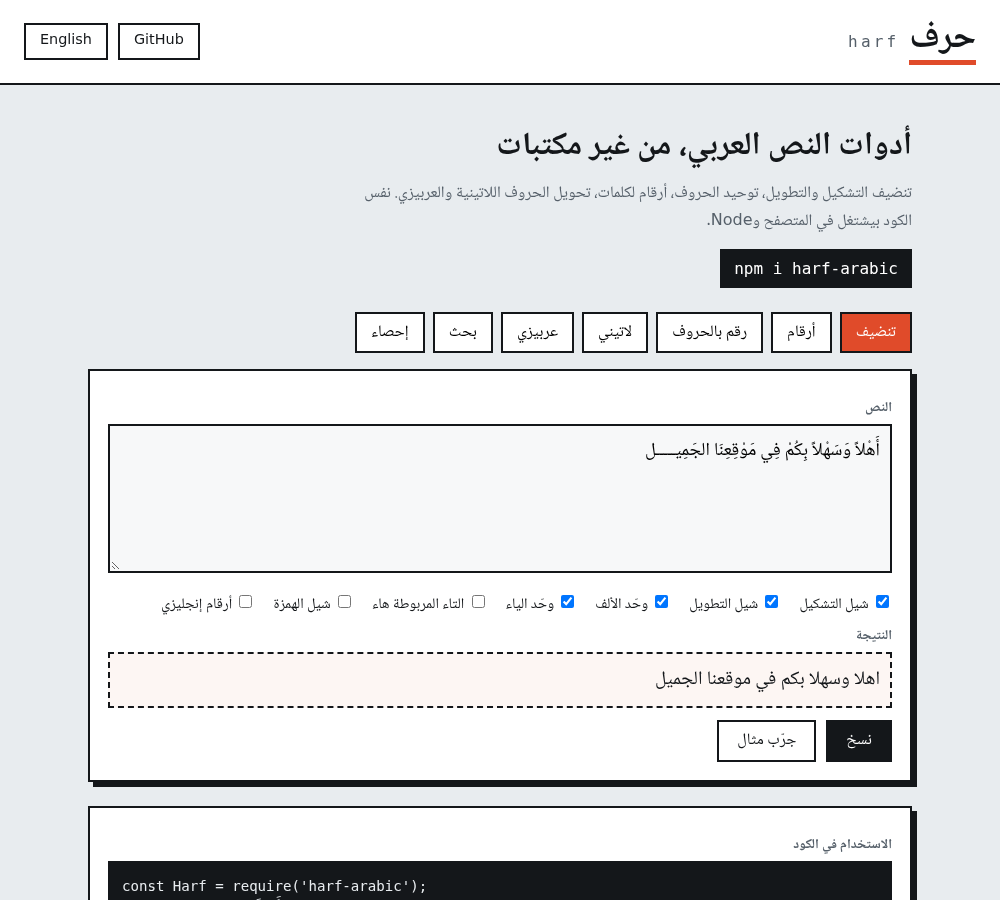
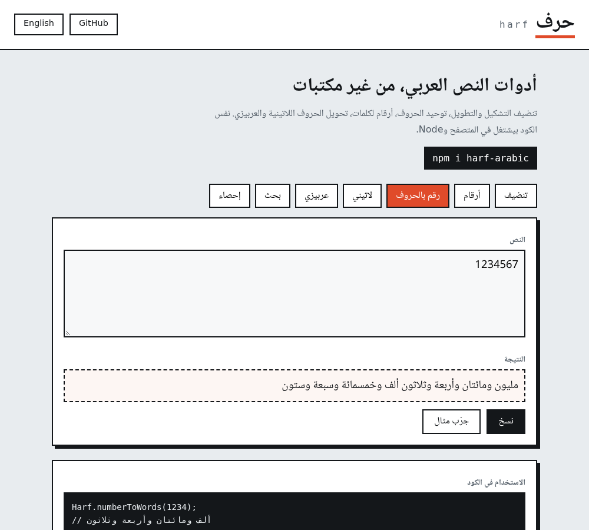
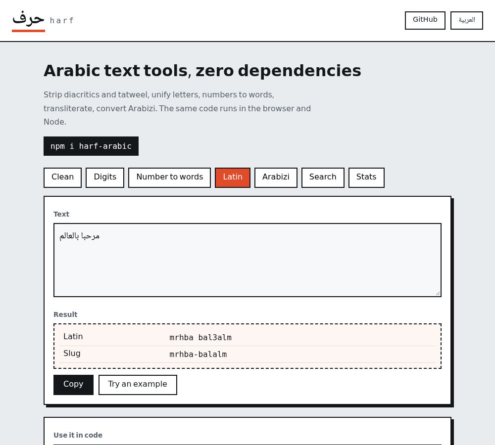

# harf (حرف)

Zero-dependency Arabic text toolkit. One file, runs in Node and in the browser, with a live playground.

مجموعة أدوات للنص العربي من غير أي مكتبات. ملف واحد بيشتغل في Node والمتصفح، ومعاه صفحة تجربة لايف.

**Live playground / التجربة لايف:** https://mostaaafaomran-ctrl.github.io/harf/



## What it does
- Strip diacritics (tashkeel) and tatweel.
- Normalize letters: alef forms, yaa, kaf, optional taa marbuta and hamza.
- Convert digits between Western, Arabic-Indic and Persian.
- Numbers to Arabic words, up to 999,999,999,999 (`1234` gives ألف ومائتان وأربعة وثلاثون).
- Transliterate Arabic to Latin, and make URL slugs.
- Convert Arabizi (`7abibi`) to Arabic (حبيبي).
- Accent-insensitive search, with an optional light stemmer.
- Text stats: words, letters, diacritics, direction, Arabic ratio.

## بيعمل إيه
- يشيل التشكيل والتطويل.
- يوحّد الحروف: أنواع الألف، الياء، الكاف، والتاء المربوطة والهمزة اختياري.
- يحوّل الأرقام بين إنجليزي وهندي وفارسي.
- يكتب الرقم بالحروف العربي لحد 999,999,999,999.
- يحوّل العربي لحروف لاتينية ويعمل slug للروابط.
- يحوّل العربيزي (`7abibi`) لعربي.
- بحث من غير حساسية للتشكيل والهمزات، مع جذع خفيف اختياري.
- إحصاء النص: كلمات، حروف، تشكيل، اتجاه، نسبة العربي.



## Install / التثبيت
```bash
npm i harf-arabic
```
Or drop `harf.js` into a page with a script tag; it exposes `window.Harf`.
أو حط `harf.js` في الصفحة بـ script tag وهيبقى متاح باسم `window.Harf`.

## Use / الاستخدام
```js
const Harf = require('harf-arabic');

Harf.stripDiacritics('مُحَمَّدٌ');          // محمد
Harf.normalize('أَحْمَد إلى مصر');          // احمد الي مصر
Harf.toArabicIndic('2026');                // ٢٠٢٦
Harf.numberToWords(2000);                  // ألفان
Harf.transliterate('محمد');                // mhmd
Harf.slugify('مرحبا بالعالم');             // mrhba-balalm
Harf.fromArabizi('3arabi');                // عربي
Harf.matches('ذهبت إلى المدرسة', 'مدرسه'); // true
Harf.stem('المدرسة');                      // مدرس
Harf.stats('مرحبا بالعالم').words;         // 2
```



## Run locally / تشغيل محلي
```bash
git clone https://github.com/mostaaafaomran-ctrl/harf.git
cd harf
npm test
```
Open `index.html` for the playground. / افتح `index.html` للتجربة.

## Notes / ملاحظات
- The stemmer is a light prefix/suffix stripper, not a full morphological analyzer.
- Transliteration is a simple readable scheme, not an academic standard.
- المقطّع (stemmer) خفيف بيشيل السوابق واللواحق، مش محلل صرفي كامل.
- Contributions welcome. / المساهمات مرحب بها.

## License
MIT
